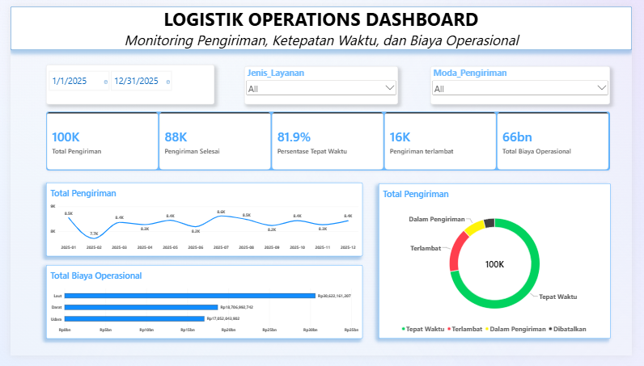

# Logistics Operations Dashboard: Power BI

Selamat datang di panduan praktik pembuatan **Logistics Operations Dashboard menggunakan Power BI**!

Pada praktikum ini, kita akan belajar mengolah data operasional logistik menjadi dashboard interaktif yang dapat digunakan untuk memantau jumlah pengiriman, ketepatan waktu, status pengiriman, dan biaya operasional.

Ikuti setiap tahapan secara berurutan. Kita akan mulai dari mengimpor data, membersihkan data, membuat perhitungan menggunakan DAX, hingga menyusun dashboard yang informatif dan menarik.

<p align="center">
  
</p>

## Apa yang Akan Kita Pelajari?

Setelah menyelesaikan praktikum ini, kamu diharapkan mampu:

- Mengolah dan memeriksa kualitas data menggunakan Power Query.
- Membuat tabel kalender dan menghubungkan antartabel.
- Menggunakan DAX untuk menghitung KPI operasional.
- Membuat visualisasi data berupa grafik, kartu KPI, dan slicer.
- Menyusun dashboard interaktif untuk membantu analisis operasional logistik.

## 1. Import dan Persiapan Data

Sebelum membuat dashboard, kita perlu memastikan bahwa data yang digunakan sudah siap untuk dianalisis.

**Langkah 1: Import dataset**

1. Buka **Power BI Desktop**.
2. Pilih **Get data → Excel workbook**.
3. Cari dan pilih file `Operasional_Logistik.xlsx`.
4. Pada jendela Navigator, pilih sheet **Data Logistik**.
5. Klik **Transform Data** untuk membuka Power Query Editor.

Mengapa kita memilih *Transform Data*? Karena kita perlu memeriksa dan memperbaiki kualitas data sebelum menggunakannya dalam visualisasi.

**Langkah 2: Periksa kualitas data**

Pada Power Query Editor, buka tab **View**, kemudian aktifkan:

- **Column quality** untuk melihat persentase data valid, error, dan kosong.
- **Column distribution** untuk melihat distribusi nilai pada setiap kolom.
- **Column profile** untuk memeriksa karakteristik data secara lebih terperinci.


**Langkah 3: Hitung total biaya setiap pengiriman**

Sekarang kita akan membuat kolom baru untuk menjumlahkan biaya pengiriman dan biaya penanganan.

1. Pilih tab **Add Column → Custom Column**.
2. Isi nama kolom dengan `Total_Biaya_Rp`.
3. Masukkan rumus berikut:

```powerquery
[Biaya_Pengiriman_Rp] + [Biaya_Penanganan_Rp]
```

4. Klik **OK**.
5. Pastikan tipe datanya sesuai, yaitu **Whole Number** atau **Decimal Number**.

Terakhir, periksa kembali nilai kosong, error, dan duplikasi. Jika sudah siap, klik **Close & Apply** untuk menerapkan perubahan ke Power BI.

## 2. Membuat Tabel Kalender

Berikutnya, kita akan membuat tabel kalender agar dashboard dapat menganalisis pengiriman berdasarkan tanggal dan bulan.

Di Power BI Desktop, pilih **Modeling → New table**, kemudian masukkan kode DAX berikut:

```dax
Kalender =
ADDCOLUMNS(
    CALENDAR(
        MIN('Data Logistik'[Tanggal_Pesanan]),
        MAX('Data Logistik'[Tanggal_Pesanan])
    ),
    "Tahun Bulan", FORMAT([Date], "yyyy-MM")
)
```

**Apa fungsi kode ini?**

- `CALENDAR()` membuat daftar tanggal dari tanggal pesanan paling awal hingga paling akhir.
- `MIN()` mengambil tanggal pesanan paling awal.
- `MAX()` mengambil tanggal pesanan paling akhir.
- `ADDCOLUMNS()` menambahkan kolom baru ke tabel kalender.
- `FORMAT([Date], "yyyy-MM")` menghasilkan format tahun-bulan, misalnya `2025-01`.

Dengan tabel ini, kita dapat menyusun grafik tren pengiriman berdasarkan waktu secara lebih terstruktur.

## 3. Menghubungkan Tabel

Setelah tabel kalender dibuat, kita perlu menghubungkannya dengan tabel utama agar filter tanggal dapat memengaruhi visualisasi dashboard.

Ikuti langkah berikut:

1. Buka **Model view**.
2. Hubungkan `Kalender[Date]` dengan `Data Logistik[Tanggal_Pesanan]`.
3. Atur **Cardinality** menjadi **One to many (1:*)**.
4. Atur **Cross-filter direction** menjadi **Single**.
5. Pastikan relasi berstatus **Active**.

Dalam relasi ini, tabel Kalender berada pada sisi **One (1)** karena setiap tanggal muncul satu kali, sedangkan Data Logistik berada pada sisi **Many (*)** karena satu tanggal dapat memiliki banyak transaksi pengiriman.

## 4. Membuat Measure dengan DAX

Sekarang kita masuk ke bagian penting dalam pembuatan dashboard, yaitu menghitung indikator yang akan ditampilkan pada kartu KPI dan grafik.

Pilih tabel **Data Logistik**, kemudian klik **Modeling → New measure**. Buat measure berikut satu per satu.

**A. Total Pengiriman**

```dax
Total Pengiriman =
DISTINCTCOUNT('Data Logistik'[ID_Pengiriman])
```

Measure ini menghitung jumlah ID pengiriman yang unik. Kita menggunakannya agar ID yang sama tidak dihitung berulang kali.

**B. Total Paket**

```dax
Total Paket =
SUM('Data Logistik'[Jumlah_Paket])
```

Measure ini menjumlahkan seluruh paket yang tercatat dalam dataset.

**C. Total Biaya Pengiriman**

```dax
Total Biaya Pengiriman =
SUM('Data Logistik'[Biaya_Pengiriman_Rp])
```

Gunakan measure ini untuk mengetahui jumlah biaya pengiriman berdasarkan data yang tersedia.

**D. Total Biaya Penanganan**

```dax
Total Biaya Penanganan =
SUM('Data Logistik'[Biaya_Penanganan_Rp])
```

Measure ini menjumlahkan biaya penanganan seluruh transaksi yang masuk dalam filter aktif.

**E. Total Biaya Operasional**

```dax
Total Biaya Operasional =
[Total Biaya Pengiriman] +
[Total Biaya Penanganan]
```

Measure ini menggabungkan total biaya pengiriman dan biaya penanganan menjadi satu indikator.

Perlu diingat, total biaya operasional pada praktikum ini hanya mencakup dua komponen biaya tersebut. Jadi, jangan langsung menganggapnya sebagai seluruh biaya operasional perusahaan.

## 5. Mendesain Dashboard

Setelah data dan measure siap, sekarang kita akan menyusun semuanya menjadi dashboard yang mudah dibaca dan digunakan.

### Langkah 1: Atur ukuran halaman

1. Buka **Report view**.
2. Klik area kosong pada halaman laporan.
3. Buka panel **Format page**.
4. Pilih **Canvas settings → Type → 16:9**.

Ukuran ini membantu kita menyusun dashboard dengan tata letak horizontal yang proporsional.

### Langkah 2: Buat judul dashboard

Letakkan judul pada bagian paling atas halaman:

**LOGISTICS OPERATIONS DASHBOARD**

Tambahkan subjudul:

*Monitoring Pengiriman, Ketepatan Waktu, dan Biaya Operasional*

Gunakan ukuran teks dan warna yang konsisten agar pengguna langsung memahami tujuan dashboard.

### Langkah 3: Tambahkan slicer atau filter

Kita akan membuat tiga slicer agar pengguna dapat mengeksplorasi data sesuai kebutuhan.

1. **Tanggal:** gunakan `Kalender[Date]`, lalu pilih gaya **Between** agar pengguna dapat menentukan rentang tanggal.
2. **Moda Pengiriman:** gunakan kolom `Moda_Pengiriman`.
3. **Jenis Layanan:** gunakan kolom `Jenis_Layanan`.

Letakkan slicer di bawah header. Untuk moda pengiriman dan jenis layanan, kamu dapat menggunakan tampilan dropdown agar tidak terlalu banyak memakan ruang.

### Langkah 4: Buat kartu KPI

Pilih visual **Card**, lalu tambahkan lima indikator berikut:

1. **Total Pengiriman**
2. **Pengiriman Selesai**
3. **Persentase Tepat Waktu**
4. **Pengiriman Terlambat**
5. **Total Biaya Operasional**

Susun kelima kartu dalam satu baris di bawah slicer.

Pastikan setiap kartu memiliki judul yang jelas dan format angka yang konsisten. Untuk nilai biaya, gunakan format Rupiah dan satuan yang mudah dipahami.

Perhatikan bahwa measure untuk pengiriman selesai, persentase tepat waktu, dan pengiriman terlambat perlu dibuat berdasarkan definisi pada kolom `Status_Pengiriman` dan, jika tersedia, kolom target waktu pengiriman. Pastikan rumusnya sesuai dengan struktur dataset sebelum digunakan.

### Langkah 5: Buat grafik tren pengiriman

Sekarang kita akan melihat perubahan jumlah pengiriman dari bulan ke bulan.

1. Pilih visual **Line chart**.
2. Masukkan `Kalender[Tahun Bulan]` ke bagian **X-axis**.
3. Masukkan `[Total Pengiriman]` ke bagian **Y-axis**.

Pastikan urutan bulan tersusun secara kronologis. Format `yyyy-MM` membantu menjaga urutan tahun dan bulan tetap konsisten.

Melalui grafik ini, kita dapat mengidentifikasi bulan dengan jumlah pengiriman tertinggi maupun terendah.

### Langkah 6: Buat grafik distribusi status

Untuk melihat komposisi status pengiriman, kita akan menggunakan **Donut chart**.

Atur visual sebagai berikut:

- **Legend:** `Status_Pengiriman`
- **Values:** `[Total Pengiriman]`

Agar informasi lebih mudah dipahami, gunakan warna yang konsisten:

- Hijau untuk **Tepat Waktu**.
- Merah untuk **Terlambat**.
- Biru untuk **Dalam Pengiriman**.
- Abu-abu untuk **Dibatalkan**.

Dengan visual ini, kita dapat melihat bagaimana pengiriman tersebar berdasarkan statusnya.

### Langkah 7: Buat grafik biaya operasional

Selanjutnya, tambahkan visual **Bar chart** untuk membandingkan biaya operasional berdasarkan kategori yang tersedia dalam dataset.

Pilih kategori yang relevan sebagai sumbu kategori, kemudian masukkan measure biaya sebagai nilai. Atur format angka agar nominal biaya mudah dibaca dan dibandingkan.

##  Hasil Akhir

Jika seluruh tahapan sudah selesai, kita telah membangun dashboard interaktif yang dapat digunakan untuk:

- Memantau jumlah pengiriman dan paket.
- Mengamati tren pengiriman bulanan.
- Melihat komposisi status pengiriman.
- Membandingkan biaya pengiriman dan penanganan.
- Memfilter data berdasarkan tanggal, moda pengiriman, dan jenis layanan.

Jangan berhenti setelah dashboard selesai dibuat. Cobalah mengubah filter tanggal atau memilih moda pengiriman yang berbeda, kemudian amati bagaimana seluruh visualisasi berubah.

**Tantangan untuk kamu:** Temukan satu insight dari dashboard, misalnya bulan dengan jumlah pengiriman tertinggi atau kategori dengan biaya operasional terbesar. Jelaskan temuan tersebut berdasarkan data yang ditampilkan.

---

*Learn the data. Understand the insight. Make better decisions.*
